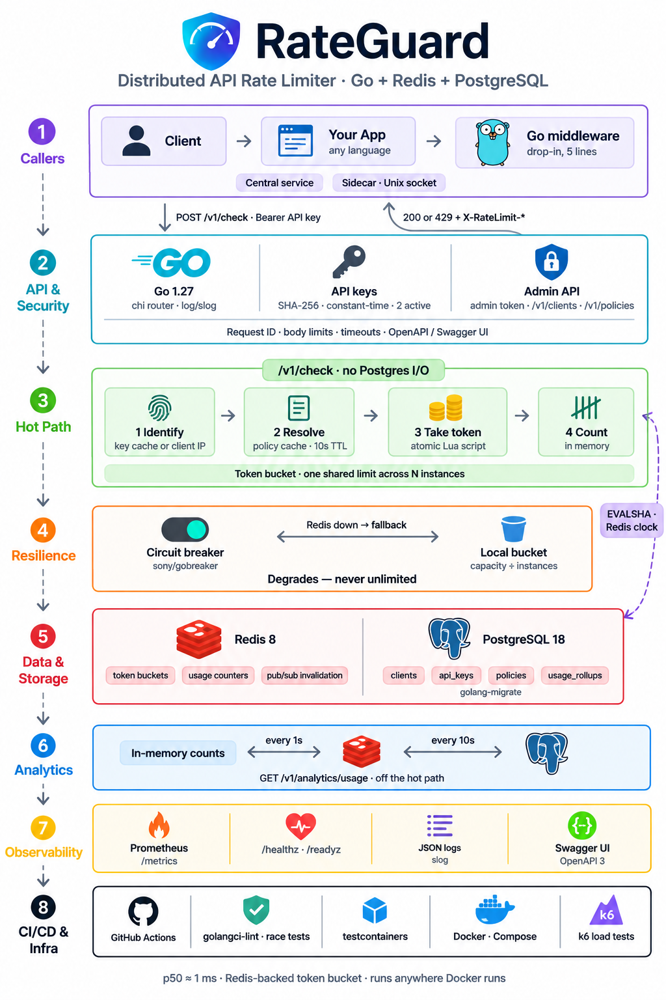

# RateGuard

A standalone, distributed API rate-limiting microservice in Go.

Applications ask RateGuard over HTTP whether a request should be allowed. RateGuard
identifies the caller, resolves its policy, and atomically consumes a token from a token
bucket shared across every RateGuard instance through Redis. Rate limiting lives in one
service instead of being re-implemented in every application, and any language that can
make an HTTP call can use it.

> **Status: v1 complete (phase 7 of 7).** RateGuard runs in Docker Compose next to
> Postgres and Redis. An admin API registers applications, rotates their API keys, and
> manages policies, endpoint rules and plan assignments. `POST /v1/check` decides against
> token buckets that every instance shares through an atomic Lua script in Redis, and
> answers with the standard `X-RateLimit-*` and `Retry-After` headers. If Redis fails, a
> circuit breaker degrades decisions to a local bucket per instance, never to unlimited.
> Usage is counted off the hot path and reported by `GET /v1/analytics/usage`,
> `GET /metrics` exposes decisions, latency, cache and Redis health, and the measured
> latency of both topologies and the hot-key ceiling are [published below](#performance).

## Architecture



Your service returns `429 Too Many Requests` to its own client when RateGuard says no.

- **Hot path** (`/v1/check`): the caller's key and policy come from in-process caches,
  then one atomic Lua script runs in Redis. There is no Postgres I/O, no synchronous
  logging and no analytics write; the check is only counted in memory
  ([ADR 0004](docs/adr/0004-the-hot-path-is-sacred.md)).
- **Off the hot path**: usage counts move into Redis every second and into Postgres every
  10 seconds ([ADR 0018](docs/adr/0018-usage-analytics-pipeline.md)).
- **Admin path** (`/v1/clients`, `/v1/policies`, `/v1/analytics`): Postgres-backed and
  guarded by an admin token.
- **Redis outage**: a circuit breaker falls back to a local bucket, never to unlimited
  ([ADR 0001](docs/adr/0001-redis-failure-degrades-to-local-bucket.md)).
- **Deployment**: one shared central service, or a sidecar next to each application on a
  Unix socket ([ADR 0017](docs/adr/0017-unix-socket-for-sidecars.md)). Both share the
  same Redis and Postgres.

The six binding design decisions, and every decision since, are recorded in
[docs/adr](docs/adr/README.md).

## Quickstart

Requirements: Docker with Compose v2, `make` and `curl`. Go 1.27.3 is needed only to
build or test outside Docker.

```bash
git clone https://github.com/Rimaz17/RateGuard.git
cd RateGuard
make up      # creates .env, builds, applies migrations, starts, waits for health checks
make smoke   # GET /healthz and GET /readyz, expects 200 from both
```

Then make a plan, register an application and decide a few requests (`TOKEN` is the
placeholder admin token from `configs/.env.example`):

```bash
TOKEN=change-me-local-only-admin-token-0000
curl -s -H "Authorization: Bearer $TOKEN" -H 'Content-Type: application/json' \
  -d '{"name":"Tour","capacity":3,"window_seconds":60,"default":true}' http://127.0.0.1:8080/v1/policies
KEY=$(curl -s -H "Authorization: Bearer $TOKEN" -H 'Content-Type: application/json' \
  -d '{"name":"Tour App"}' http://127.0.0.1:8080/v1/clients | sed -n 's/.*"key":"\([^"]*\)".*/\1/p')
for i in 1 2 3 4; do
  curl -s -w ' %{http_code}\n' -H "Authorization: Bearer $KEY" -H 'Content-Type: application/json' \
    -d '{"method":"GET","path":"/api/products"}' http://127.0.0.1:8080/v1/check
done
# three 200s, then {"allowed":false,...,"retry_after":20} 429
sleep 12   # usage reaches Postgres within about 11 seconds
curl -s -H "Authorization: Bearer $TOKEN" 'http://127.0.0.1:8080/v1/analytics/usage?top=3'
# {"from":...,"totals":{"requests":4,"allowed":3,"rejected":1},...,"clients":[{"name":"Tour App",...}],...}
make down
```

The new application has no plan of its own, so it uses the default policy: 3 requests,
refilling one every 20 seconds.

If your `.env` predates phase 2, add `RG_ADMIN_TOKEN` to it (see
[configs/.env.example](configs/.env.example)); Compose refuses to start without it.

`make up` binds RateGuard to `127.0.0.1:8080`, Postgres to `127.0.0.1:5433` and Redis to
`127.0.0.1:6379`. To change the host ports, edit `.env`. A one-shot `migrate` service
applies the schema before RateGuard starts
([ADR 0007](docs/adr/0007-migrations-run-as-a-separate-step.md)).

To see the shared limit across instances, `make demo` starts three RateGuard instances
behind an nginx load balancer on `127.0.0.1:8090` and runs
[scripts/demo-distributed.sh](scripts/demo-distributed.sh): 300 concurrent requests for a
client limited to 100 (exactly 100 are allowed), then Redis is stopped (every request is
still decided, from local buckets) and started again (the circuit breakers close).
`make demo-down` stops it.

Without `make` (on Windows, for example), run the equivalent commands directly:

```bash
cp configs/.env.example .env
docker compose up -d --build --wait
curl -i http://127.0.0.1:8080/healthz
curl -i http://127.0.0.1:8080/readyz
```

## Configuration

RateGuard reads `RG_`-prefixed environment variables. A variable that is set but empty
takes its default. [configs/.env.example](configs/.env.example) documents every variable, including the
ones that only Docker Compose reads.

| Variable | Default | Meaning |
|---|---|---|
| `RG_HTTP_ADDR` | `:8080` | Address the HTTP server listens on |
| `RG_HTTP_READ_HEADER_TIMEOUT` | `5s` | Maximum time to read request headers |
| `RG_HTTP_READ_TIMEOUT` | `10s` | Maximum time to read the whole request |
| `RG_HTTP_WRITE_TIMEOUT` | `10s` | Maximum time to write the response |
| `RG_HTTP_IDLE_TIMEOUT` | `120s` | Keep-alive idle timeout |
| `RG_SHUTDOWN_TIMEOUT` | `15s` | Grace period for in-flight requests on SIGINT/SIGTERM |
| `RG_LOG_LEVEL` | `info` | `debug`, `info`, `warn` or `error` |
| `RG_DATABASE_URL` | *(required)* | PostgreSQL connection string; treated as a secret and never logged |
| `RG_DATABASE_MAX_CONNS` | `10` | Connection pool size (at least 1) |
| `RG_DATABASE_MAX_CONN_LIFETIME` | `30m` | Recycle pooled connections after this long |
| `RG_DATABASE_MAX_CONN_IDLE_TIME` | `5m` | Close pooled connections idle for this long |
| `RG_REDIS_URL` | `redis://localhost:6379/0` | Redis URL; treated as a secret and never logged |
| `RG_REDIS_TIMEOUT` | `100ms` | Longest a bucket operation in Redis may take before it counts as a failure |
| `RG_REDIS_FAILURE_MODE` | `local` | While Redis is unreachable: `local` (in-memory bucket per instance), `open` (allow all) or `closed` (refuse all) ([ADR 0014](docs/adr/0014-degraded-decisions.md)) |
| `RG_REDIS_BREAKER_FAILURES` | `5` | Consecutive failed bucket operations that open the circuit breaker (at least 1) |
| `RG_REDIS_BREAKER_COOLDOWN` | `5s` | How long the breaker stays open before one request probes Redis again |
| `RG_UNIX_SOCKET` | *(empty)* | Absolute path of a Unix socket to also serve on, for sidecars; empty means TCP only ([ADR 0017](docs/adr/0017-unix-socket-for-sidecars.md)) |
| `RG_UNIX_SOCKET_MODE` | `0660` | Octal permission of the socket file; its peers are trusted to set `X-Forwarded-For` |
| `RG_INSTANCE_COUNT` | `1` | Instances sharing the traffic; local buckets hold `capacity / RG_INSTANCE_COUNT` while Redis is down |
| `RG_USAGE_FLUSH_INTERVAL` | `1s` | How often each instance adds its usage counts into Redis ([ADR 0018](docs/adr/0018-usage-analytics-pipeline.md)) |
| `RG_USAGE_ROLLUP_INTERVAL` | `10s` | How often usage counts move from Redis into Postgres; analytics lag by about both intervals |
| `RG_READINESS_TIMEOUT` | `2s` | Per-dependency timeout for the `/readyz` checks |
| `RG_TRUSTED_PROXIES` | *(empty)* | Comma-separated CIDRs whose `X-Forwarded-For` is believed for IP identification; empty trusts none |
| `RG_ADMIN_TOKEN` | *(required)* | Bearer token for the admin API, at least 32 characters ([ADR 0008](docs/adr/0008-admin-api-bearer-token.md)) |

Every timeout must be positive. RateGuard exits at startup if any configuration value is
invalid.

## API

| Method and path | Purpose | Status |
|---|---|---|
| `GET /healthz` | Liveness: the process is up and serving | Available |
| `GET /readyz` | Readiness: Postgres and Redis are reachable (200, or 503 naming the one that is not) | Available |
| `POST /v1/clients` | Register an application; returns its first API key, once | Available |
| `GET /v1/clients`, `GET /v1/clients/{id}` | List (paged) and read applications | Available |
| `GET /v1/clients/{id}/keys` | List an application's keys, by prefix only | Available |
| `POST /v1/clients/{id}/keys`, `DELETE /v1/clients/{id}/keys/{keyID}` | Issue a second key for rotation; revoke a key | Available |
| `POST /v1/policies`, `GET /v1/policies`, `GET/PATCH/DELETE /v1/policies/{id}` | Create, list, read, update and disable policies | Available |
| `GET/POST /v1/policies/{id}/rules`, `DELETE /v1/policies/{id}/rules/{ruleID}` | A policy's endpoint rules | Available |
| `PUT /v1/clients/{id}/policy` | Assign a policy to an application, or remove it with `null` | Available |
| `POST /v1/check` | Rate-limit decision: takes a token, answers 200 or 429 ([ADR 0015](docs/adr/0015-decision-endpoint.md)) | Available |
| `GET /metrics` | Prometheus scrape: decisions, latency, cache hit ratio, Redis and breaker health, usage losses | Available |
| `POST /v1/peek` | Report the allowance without taking a token ([ADR 0016](docs/adr/0016-rate-limit-headers-and-peek.md)) | Available |
| `GET /openapi.yaml` | The OpenAPI document this binary was built with | Available |
| `GET /v1/analytics/usage` | Usage: totals, the most throttled clients, and volume by the minute or hour ([ADR 0018](docs/adr/0018-usage-analytics-pipeline.md)) | Available |

The `/v1/clients`, `/v1/policies` and `/v1/analytics` routes require `Authorization: Bearer <RG_ADMIN_TOKEN>`
([ADR 0008](docs/adr/0008-admin-api-bearer-token.md)). Every error response, routing
misses included, is `{"error": "...", "request_id": "..."}`, and never carries internal
detail; a 405 also lists the accepted methods in `Allow`. `make docs` serves Swagger UI
for the contract on `127.0.0.1:8081` (read-only: try-it-out is off).

Every response carries an `X-Request-ID` header. An inbound `X-Request-ID` is reused if
it is at most 64 characters of `[A-Za-z0-9._-]`; otherwise RateGuard generates a new one.
The contract is [api/openapi.yaml](api/openapi.yaml) (OpenAPI 3.1), updated in the same
commit as any handler.

### Registering an application and rotating its key

With the stack from the quickstart running (the token is the placeholder from
`configs/.env.example`):

```bash
TOKEN=change-me-local-only-admin-token-0000

# Register: the response holds the full key. It is shown once and never again.
curl -s -H "Authorization: Bearer $TOKEN" -H 'Content-Type: application/json' -d '{"name":"Customer App"}' http://127.0.0.1:8080/v1/clients
# {"client":{"id":"<client-id>",...},"api_key":{"id":"<key-id>","prefix":"rg_cus_...","key":"rg_cus_..._...",...}}

# Rotate without downtime: issue a second key, move your callers onto it...
curl -s -H "Authorization: Bearer $TOKEN" -X POST http://127.0.0.1:8080/v1/clients/<client-id>/keys

# ...then revoke the old one.
curl -s -H "Authorization: Bearer $TOKEN" -X DELETE http://127.0.0.1:8080/v1/clients/<client-id>/keys/<key-id>
```

A key reads `rg_<tag>_<16 characters>_<52 characters>`. The tag comes from the
application's name (`rg_cus_` for "Customer App"), so keys are easy to attribute. The
part up to the second underscore is the public prefix: it is what logs and the admin
API show. RateGuard stores only the SHA-256 digest of the full key
([ADR 0006](docs/adr/0006-api-keys-sha256-two-active.md)). An application can hold two
active keys at once, so a third is refused with `409` until one is revoked.

Keys are presented to the decision endpoint as `Authorization: Bearer <key>` (see
below). A caller without a key is identified by its IP address. `X-Forwarded-For` is only
believed from the proxies listed in `RG_TRUSTED_PROXIES`.

### Policies, endpoint rules and plans

A policy is a named limit such as "100 requests per 60 seconds". An endpoint rule gives
part of an API its own limit inside a policy, so `/api/login` can be far stricter than
the rest:

```bash
# The Free plan, made the default for callers without a plan of their own.
curl -s -H "Authorization: Bearer $TOKEN" -H 'Content-Type: application/json' -d '{"name":"Free","capacity":100,"window_seconds":60,"default":true}' http://127.0.0.1:8080/v1/policies
# {"id":"<policy-id>","name":"Free","capacity":100,"window_seconds":60,"refill_rate":1.6666666666666667,"enabled":true,"default":true,...}

# 5 login attempts a minute on the Free plan.
curl -s -H "Authorization: Bearer $TOKEN" -H 'Content-Type: application/json' -d '{"method":"POST","path_pattern":"/api/login","capacity":5,"window_seconds":60}' http://127.0.0.1:8080/v1/policies/<policy-id>/rules

# Put an application on the plan ({"policy_id":null} takes it off again).
curl -s -H "Authorization: Bearer $TOKEN" -X PUT -H 'Content-Type: application/json' -d '{"policy_id":"<policy-id>"}' http://127.0.0.1:8080/v1/clients/<client-id>/policy

# Change the plan's limit; DELETE disables it.
curl -s -H "Authorization: Bearer $TOKEN" -X PATCH -H 'Content-Type: application/json' -d '{"capacity":200}' http://127.0.0.1:8080/v1/policies/<policy-id>
```

Which limit applies to a request ([ADR 0009](docs/adr/0009-policy-resolution-and-default-policy.md)):

1. A caller with an API key uses its application's policy, if it has one and it is
   enabled.
2. Anyone else, including a caller identified by IP, uses the default policy, if there is
   one and it is enabled.
3. Otherwise the caller has no policy and will be refused: RateGuard never falls back to
   "unlimited".

Within that policy, the most specific matching endpoint rule beats the policy's own
limit ([ADR 0010](docs/adr/0010-endpoint-rule-matching-and-precedence.md)). A pattern's
segments are literals, `*` for exactly one segment, or a final `**` for any number.
Patterns are compared from the left, and at the first difference a literal beats `*`,
which beats `**`. Between equally specific patterns, a rule naming the request's method
beats one for `*`. Request paths are cleaned first, so `/api/login/` cannot dodge a
rule on `/api/login`. A refill rate defaults to `capacity / window_seconds`; set
`refill_rate` on a policy to allow bursts above the sustained rate.

Every instance caches resolution data for 10 seconds, and every admin write publishes
the changed ID on the Redis channel `rg:policy:invalidate`, so each instance drops it at
once ([ADR 0005](docs/adr/0005-policy-cache-ttl-pubsub-singleflight.md)). The
integration suite measures a plan change made on one instance becoming visible on
another in tens of milliseconds, and the 10-second TTL only matters if a message is lost.

### Checking a request

Your application calls `POST /v1/check` with the method and path of the request it
received, and forwards the caller's `Authorization` header if it sent one
([ADR 0015](docs/adr/0015-decision-endpoint.md)):

```bash
curl -s -w ' %{http_code}\n' -H "Authorization: Bearer $KEY" -H 'Content-Type: application/json' \
  -d '{"method":"GET","path":"/api/products"}' http://127.0.0.1:8080/v1/check
# {"allowed":true,"limit":100,"remaining":99,"reset_after":1} 200
# ...and once the bucket is empty:
# {"allowed":false,"limit":100,"remaining":0,"reset_after":60,"retry_after":1} 429
```

The status is the answer: 200 to serve the request, 429 to refuse it. Durations are whole
seconds, rounded up. Both carry headers your service can copy onto its own response
unchanged ([ADR 0016](docs/adr/0016-rate-limit-headers-and-peek.md)):

| Header | Value |
|---|---|
| `X-RateLimit-Limit` | `limit` |
| `X-RateLimit-Remaining` | `remaining` |
| `X-RateLimit-Reset` | `reset_after`: seconds until the bucket is full again, not a timestamp |
| `Retry-After` | On 429 only: `retry_after`, at least 1 |

`POST /v1/peek` takes the same body and reports the same fields without taking a token.
It always answers 200, with `allowed` saying what a check would do. A bad key is a 401, never a quiet fallback to IP, and a caller with
no applicable policy gets a 403. Send the path only: a query string or fragment is
refused, because `/api/login?x` would otherwise escape a rule on `/api/login`. Without a
key, the caller is identified by IP, so an application that wants per-IP limits appends
its caller's address to `X-Forwarded-For` and has its network listed in
`RG_TRUSTED_PROXIES`.

A decision reads no database. Policies and API keys come from in-process caches kept in
sync over Redis pub/sub ([ADR 0005](docs/adr/0005-policy-cache-ttl-pubsub-singleflight.md),
[ADR 0012](docs/adr/0012-api-key-cache-on-the-hot-path.md)), and a revoked key stops
working on every instance within milliseconds.

### Integrating from Go

[examples/go-middleware](examples/go-middleware) is a reference `net/http` middleware,
in a module of its own with no dependencies beyond the standard library:

```go
rg, err := rateguard.New(os.Getenv("RATEGUARD_URL"))
if err != nil {
	log.Fatal(err)
}
handler := rg.Middleware(mux)
```

It forwards each request's method, decoded path, `Authorization` header and address,
keeps a pool of keep-alive connections to RateGuard, copies the rate-limit headers onto
your responses, and answers 429 itself when RateGuard refuses. If RateGuard cannot be
reached it answers 503, unless you choose `WithFailOpen()`. The
[sample app](examples/go-middleware/sampleapp/main.go) is a complete service built this
way, and CI runs the middleware against the real stack.

### Sidecar deployment

Set `RG_UNIX_SOCKET` to an absolute path, and RateGuard also serves its whole API on that
Unix socket, alongside TCP ([ADR 0017](docs/adr/0017-unix-socket-for-sidecars.md)). The
file is created with `RG_UNIX_SOCKET_MODE` (`0660` by default). A stale socket left by a
crash is replaced, but a live socket or any other file at that path stops startup
untouched, and the file is removed on shutdown. Point the middleware at it with
`rateguard.New("unix:///run/rateguard/rateguard.sock")`.

Over the socket, a caller without an API key is identified by the address the
application adds to `X-Forwarded-For`, because only processes the file's permissions let
in can connect. Keep the mode tight for that reason. The latency of both topologies is
under [Performance](#performance).

### Shared buckets in Redis

Every instance draws from the same buckets. Refill and take run as one Lua script in
Redis, loaded with `EVALSHA`, so concurrent requests on any instance cannot overspend a
bucket. The script reads Redis's clock, so clock skew between instances cannot matter,
and it returns only relative values ([ADR 0002](docs/adr/0002-redis-is-the-only-clock.md),
[ADR 0013](docs/adr/0013-redis-bucket-store.md)). A bucket is a hash under
`rg:bucket:<scope>:<caller>`, where the scope is `all` or an endpoint rule's ID and the
caller is `client:<id>` or `ip:<address>`; IPv6 callers are keyed by their `/64`. Keys
expire when the bucket would be full again, so idle callers cost nothing. Every key is
built by one function, so sharding a hot key later is a one-line change
([ADR 0003](docs/adr/0003-no-hot-key-sharding-in-v1.md)).

The integration suite runs three instances behind a round-robin load balancer: a client
limited to 100 gets exactly 100 of 300 concurrent requests through, although each
instance serves 100 of them. With per-instance memory instead, all 300 get through.

### When Redis fails

A circuit breaker wraps every bucket call, each bounded by `RG_REDIS_TIMEOUT`. After
`RG_REDIS_BREAKER_FAILURES` consecutive failures it opens, and decisions follow
`RG_REDIS_FAILURE_MODE` ([ADR 0001](docs/adr/0001-redis-failure-degrades-to-local-bucket.md),
[ADR 0014](docs/adr/0014-degraded-decisions.md)):

| Mode | While Redis is unreachable |
|---|---|
| `local` (default) | Each instance decides from its own bucket of `capacity / RG_INSTANCE_COUNT` (rounded down, at least 1), refilling at `rate / RG_INSTANCE_COUNT` |
| `open` | Every request is allowed |
| `closed` | Every request is refused, with `retry_after` set to the breaker's cooldown |

After `RG_REDIS_BREAKER_COOLDOWN` one request probes Redis; if it succeeds, the breaker
closes and Redis's buckets decide again from where they were left. Every degraded
decision increments `rateguard_degraded_decisions_total`, and
`rateguard_redis_breaker_state` reads 0, 1 or 2 for closed, half-open and open. The log
gets a WARN when the breaker opens, at most one WARN every 10 seconds while degraded
(with a count, rather than a line per decision), and an INFO when it closes. Set
`RG_INSTANCE_COUNT` to the number of instances you run, or the local buckets will be the
wrong size.

The integration suite kills Redis mid-test under three instances: every request is still
answered, each instance allows exactly its local share, all of it shows in `/metrics`,
and once Redis returns the breakers close and Redis's balance applies again.

### Usage analytics

`GET /v1/analytics/usage` reports how many checks were allowed and rejected
([ADR 0018](docs/adr/0018-usage-analytics-pipeline.md)):

```bash
curl -s -H "Authorization: Bearer $TOKEN" \
  'http://127.0.0.1:8080/v1/analytics/usage?from=2026-11-05T09:00:00Z&to=2026-11-05T10:00:00Z&granularity=minute&top=5'
```

```json
{
  "from": "2026-11-05T09:00:00Z", "to": "2026-11-05T10:00:00Z", "granularity": "minute",
  "totals":       {"requests": 1300, "allowed": 1200, "rejected": 100},
  "unidentified": {"requests": 40, "allowed": 40, "rejected": 0},
  "clients": [
    {"client_id": "...", "name": "Customer App", "requests": 900, "allowed": 820, "rejected": 80}
  ],
  "series": [
    {"start": "2026-11-05T09:00:00Z", "requests": 21, "allowed": 21, "rejected": 0}
  ]
}
```

| Parameter | Default | Meaning |
|---|---|---|
| `from`, `to` | the last 24 hours | RFC 3339 times; the range is widened to whole minutes or hours, in UTC, and the response says which range it answered |
| `granularity` | `hour` | `minute` or `hour`; a series holds at most 1,440 points (a day by the minute, 60 days by the hour) |
| `top` | `10` | How many clients to rank, from 1 to 100 |

`clients` ranks applications by rejections, then by requests, so the most throttled
come first. `unidentified` counts callers without an API key, who are known by IP;
their addresses are never stored. `series` has a point for every minute or hour,
zeros included. Peeks are not counted.

A decision only counts itself in memory. Every second each instance adds its counts to
one hash per minute in Redis, and every 10 seconds any instance drains those hashes
into the `usage_rollups` table. A drain reads and deletes in one Lua script, so no two
instances take the same counts and no leader is needed. Reports therefore lag by about
11 seconds. An instance that crashes loses up to a second of its counts, and every loss
the service can see increments `rateguard_usage_dropped_total`.

### Observability

**Metrics.** `GET /metrics` serves Prometheus metrics from a registry of the service's
own ([ADR 0014](docs/adr/0014-degraded-decisions.md),
[ADR 0019](docs/adr/0019-decision-and-cache-metrics.md)). No label carries a client, a
key or an address.

| Metric | Labels | What it shows |
|---|---|---|
| `rateguard_decisions_total` | `outcome`: `allowed`, `rejected`, `no_policy`, `error` | Checks by outcome |
| `rateguard_decision_duration_seconds` | `operation`: `check`, `peek` | Histogram of the server's time per decision request, from 100µs to 1s |
| `rateguard_cache_lookups_total` | `cache`: `api_key`, `client_policy`, `policy`, `default_policy`; `result`: `hit`, `miss` | Hit ratio of the caches that keep Postgres off the hot path |
| `rateguard_degraded_decisions_total` | `mode`: `local`, `open`, `closed` | Decisions made without Redis |
| `rateguard_redis_errors_total` | | Failed or timed-out bucket calls |
| `rateguard_redis_breaker_state` | | 0 closed, 1 half-open, 2 open |
| `rateguard_usage_dropped_total` | | Checks lost to analytics |

Plus the Go runtime and process collectors. For example:

```promql
# p99 decision latency per instance
histogram_quantile(0.99, sum by (instance, le) (rate(rateguard_decision_duration_seconds_bucket{operation="check"}[5m])))
# share of checks refused
sum(rate(rateguard_decisions_total{outcome="rejected"}[5m])) / sum(rate(rateguard_decisions_total[5m]))
# cache hit ratio, per cache
sum by (cache) (rate(rateguard_cache_lookups_total{result="hit"}[5m])) / sum by (cache) (rate(rateguard_cache_lookups_total[5m]))
```

**Logs.** JSON lines on stdout through `log/slog`. Every request gets an ID (reused from
a valid inbound `X-Request-ID`, otherwise generated), returned in `X-Request-ID` and
included in every log line about that request. Nothing is logged per decision
([ADR 0004](docs/adr/0004-the-hot-path-is-sacred.md)): an outage shows as one WARN when
the breaker opens and at most one every 10 seconds while degraded, and a failed request
as one ERROR with its request ID. API keys appear only as their public prefix.

**Probes.** `/healthz` answers while the process is up; `/readyz` checks Postgres and
Redis and answers 503 naming whichever is unreachable.

### The token bucket

Each caller's bucket holds up to `capacity` tokens and refills continuously at
`refill_rate` tokens a second. A request takes one token, and an empty bucket refuses
it. Refill is computed lazily from the elapsed time whenever the bucket is used, so no
timers run. A burst can use the whole capacity at once, while the long-run rate stays at
the refill rate. [ADR 0011](docs/adr/0011-token-bucket-semantics.md) pins down the
details so every store decides identically:

| Field | Meaning |
|---|---|
| `limit` | The bucket's capacity |
| `remaining` | Whole tokens left after this decision |
| `reset_after` | Time until the bucket is full again if nothing else uses it |
| `retry_after` | On a refusal only: time until one token is back. Retrying then is allowed |

The engine (`internal/limiter/engine.go`) is a pure function of a bucket's state, its
limit and the time it is given. It never reads a clock itself. The Lua script ports it
step by step on Redis's clock, and the integration suite replays real script calls
through the engine and expects identical results. The in-memory store applies the engine
under a mutex; it is the fallback when Redis is down, and it deletes buckets that have
refilled to capacity, since they decide exactly as new ones do.

The tests check, without any network:

- bursts and steady drain: exactly `capacity + rate × elapsed` requests get through,
  never one more;
- refill boundaries at and around the nanosecond a token is due;
- a clock that stands still or jumps back;
- capacity raised and lowered under a client;
- degenerate limits;
- a fuzz test of the invariants;
- concurrent consumption under `-race`: 3,200 racing takes on a bucket of 1,000 admit
  exactly 1,000.

## Data model

PostgreSQL holds the configuration (policies and their endpoint rules, clients and their
API keys) and per-minute usage. Redis holds only ephemeral state: buckets, usage counts
not yet rolled up, and the invalidation channel. The schema lives in
[`migrations/`](migrations) as reversible, numbered pairs.

| Store | Holds |
|---|---|
| `policies` table | Named rate limits: capacity, window, refill rate, enabled flag, and which one is the default |
| `endpoint_rules` table | A policy's own limits for particular methods and path patterns |
| `clients` table | Registered applications, their status and assigned policy |
| `api_keys` table | Each client's keys: public prefix, SHA-256 digest, revocation time |
| `usage_rollups` table | Checks allowed and rejected per client (or for all callers known by IP) per minute |
| Redis `rg:bucket:*` | One hash per active bucket: `tokens` and `last_refill_us`, expiring when full |
| Redis `rg:usage:*` | Usage counts on their way from the instances to `usage_rollups` |
| Redis `rg:policy:invalidate` | Pub/sub channel carrying `client:<id>` and `policy:<id>` changes |

Column-level detail and the conventions behind it are in
[docs/data-model.md](docs/data-model.md).

## Development

```bash
make help             # list every target
make check            # gofmt check, go vet, golangci-lint, go test -race: run before committing
make test             # unit tests with the race detector
make test-integration # testcontainers suite against real Postgres and Redis (needs Docker)
make cover            # race-tested unit tests with coverage.out; make cover-engine then checks the engine's 90% floor
make lint-docker      # the pinned golangci-lint in Docker, if it is not installed locally
make run              # run on the host with the current environment
make load             # k6 and socket benchmarks against the compose stack (about 25 minutes; see Performance)
```

### Migrations

The schema lives in [`migrations/`](migrations) as numbered `.up.sql` / `.down.sql`
pairs, embedded in the binary. Against the compose database:

```bash
make migrate-version     # current schema version
make migrate-down        # revert the last migration (N=3 for three)
make migrate-up          # apply everything pending
```

Outside Compose, run the binary directly: `rateguard migrate up | down [N] | version`,
with `RG_DATABASE_URL` set. An applied migration is never edited; changes go in a new
pair.

The race detector needs cgo. On a machine without a C toolchain, run the tests in the Go
image:

```bash
docker run --rm -v "$PWD:/src" -w /src golang:1.27.3 go test -race ./...
```

The integration suite starts its own containers with testcontainers-go, so it needs a
reachable Docker daemon. When running it inside a container on Docker Desktop, mount the
Docker socket and set `TESTCONTAINERS_HOST_OVERRIDE=host.docker.internal`.

CI ([.github/workflows/ci.yml](.github/workflows/ci.yml)) runs on every push and pull
request: format, vet, lint and race-tested unit tests, with the token bucket engine held
to at least 90% statement coverage; the integration suite, which
includes a migrations up/down/up round trip on a fresh database; and an image build
followed by `make up`, `make smoke`, checks of the admin API (clients, then a policy
with a rule assigned to a client, and the instance's subscription to policy changes), a
decision through `/v1/check` with its bucket in Redis and `/metrics`, the rate-limit
headers, a peek, `/openapi.yaml` and a JSON 404, the Go middleware's end-to-end test, a
usage report that reaches Postgres through Redis, the phase 7 metrics, a smoke run of
the k6 scripts, a migrate down and up through the binary, and a check that `/readyz`
turns 503 when Postgres stops and 200 when it returns; the middleware module's own
format, vet, lint and race tests; and `make demo`, the three-instance demo above.

### Layout

```
cmd/rateguard/            composition root: wiring and the migrate subcommand
internal/config/          environment configuration and validation
internal/domain/          entities and sentinel errors; standard library only
internal/client/          client registration, API key issue, rotation and authentication
internal/policy/          policy and rule management, resolution, its cache and pub/sub sync
internal/cache/           the TTL + singleflight cache behind policies and API keys
internal/analytics/       usage recorder, Redis flusher, rollup to Postgres, and reports
internal/analytics/scripts the add and drain Lua scripts for usage counts
internal/limiter/         token bucket engine, Redis and in-memory stores, circuit breaker, keys
internal/limiter/scripts  the refill-and-consume Lua script
internal/storage/postgres pgx pool, repositories and the migrator
internal/transport/http   chi router, handlers and middleware (package httptransport)
migrations/               numbered SQL migrations, embedded in the binary
api/                      the HTTP contract (openapi.yaml), embedded and served by the binary
examples/go-middleware/   reference Go middleware and sample app (a module of its own)
scripts/                  the distributed demo, its nginx config, and the load test runner
test/integration/         testcontainers suite (build tag: integration)
test/load/                k6 scripts and the Unix-socket benchmark (socketbench)
docs/                     data model and architecture decision records
```

## Performance

Measured on 2026-11-05 at commit `312c006` with `make load`
([ADR 0020](docs/adr/0020-how-latency-and-the-key-ceiling-are-measured.md),
[test/load](test/load/README.md)) on one laptop: an Intel Core i5-10210U (4 cores, 8
threads, 1.6 GHz base), 16 GB of RAM, Windows 11 and Docker Desktop 29.2.1 on WSL2 (8
CPUs and 7.7 GB for Docker). k6, RateGuard, Redis and Postgres all ran on it at once.
Treat the figures as the cost of the decision path on modest hardware, not as a server
benchmark, and re-measure on your own.

Every request below was an allowed take that wrote its bucket in Redis (the most
expensive decision), every one was answered 200, and warm-up was not measured.

### Latency: central and sidecar

One instance, 100 API keys, requests arriving at a fixed rate for 60 seconds:

| Topology | Client | p50 at 250/s | p99 at 250/s | p50 at 1,000/s | p99 at 1,000/s |
|---|---|---|---|---|---|
| Central, over the Docker network | k6 | 1.44 ms | 26.4 ms | 0.89 ms | 41.8 ms |
| Sidecar, loopback TCP | k6 | 1.40 ms | 23.9 ms | 1.59 ms | 89.9 ms |
| Sidecar, Unix socket | Go ([socketbench](test/load/socketbench/main.go)) | 1.08 ms | 15.4 ms | 1.11 ms | 92.3 ms |
| Sidecar, loopback TCP | Go ([socketbench](test/load/socketbench/main.go)) | 0.86 ms | 9.1 ms | 1.20 ms | 80.1 ms |

RateGuard's own view of the same runs, from `rateguard_decision_duration_seconds`, put
the median at or under 1 ms in every run (the histogram resolves bucket bounds, not
exact values). Its p99 was at most 10 to 25 ms at 250 a second, and at most 25 to
100 ms at 1,000.

What the numbers say, and what they do not:

- **A decision costs about a millisecond at the median,** as the caller sees it, and
  less than that inside RateGuard.
- **On one machine the topologies cannot be told apart.** The difference between
  crossing Docker's bridge and staying on loopback, or between TCP and the Unix socket,
  is smaller than the noise between runs; the socket was not consistently faster than
  loopback TCP here. What a sidecar saves in a real deployment is the network round trip between
  hosts, which a single machine cannot show. Add your own network's round trip to the
  central figures.
- **The tail comes from sharing the CPU, not from the network.** The service's own p99
  is close to the caller's, and it grows with load: the load generator, RateGuard and
  Redis compete for the same 8 logical CPUs, and in a saturation run k6 alone used more
  CPU than RateGuard. On this laptop the overview's single-digit-millisecond budget
  holds at the median, and at p90 in every run but one (k6 on the sidecar at 1,000 a
  second, 15.3 ms); it does not hold at p99.

### Throughput and the per-key ceiling

k6 with 100 virtual users sending back to back for 30 seconds
([ADR 0003](docs/adr/0003-no-hot-key-sharding-in-v1.md)):

| Run | Requests a second | p50 | p99 |
|---|---|---|---|
| One instance, one hot key | 4,921 | 14.5 ms | 93.7 ms |
| One instance, 100 keys | 4,757 | 15.2 ms | 99.0 ms |
| Three instances behind nginx, one hot key | 2,503 | 28.5 ms | 170.0 ms |
| Three instances behind nginx, 100 keys | 2,386 | 30.1 ms | 179.2 ms |
| Redis alone: the bucket script on one key (`redis-benchmark`, 50 connections) | 19,680 | | |
| Redis alone: the bucket script on random keys | 20,740 | | |

- **The per-key ceiling is about 19,700 decisions a second on this machine,** the rate
  at which Redis runs the bucket script on a single key. It is the same as on random
  keys, because one Redis runs every script on one thread: with a single Redis, one
  key's ceiling is Redis's ceiling.
- **End to end, the hot key was never the limit.** One key and 100 keys ran at the same
  rate, about 4,900 decisions a second through one instance, bound by CPU. Three
  instances on the same four cores were slower than one, since nginx and two more
  processes compete for those cores: scaling out needs more machines, not more
  processes on one.
- **Runs vary.** Repeats of the same single-instance run on this laptop ranged from about
  1,750 to 4,900 requests a second, depending on how hot the CPU was. The figures above
  come from one run, with 20 idle seconds before each measurement.
- **Sharding.** A client that needs more than the ceiling needs its bucket split into
  `K` sub-buckets of `capacity / K`, picked at random, as ADR 0003 plans. Because a
  single Redis caps every key together, the sub-buckets only raise the ceiling when they
  live on different Redis nodes. `keyFor` is still the one place to change.
